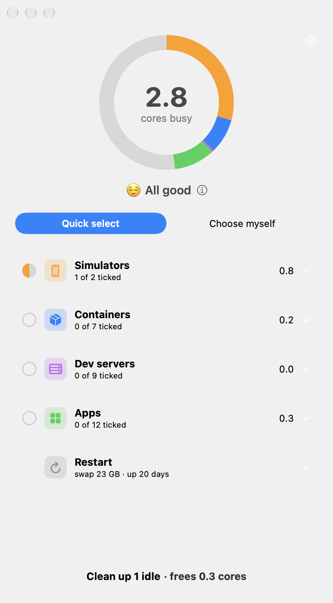
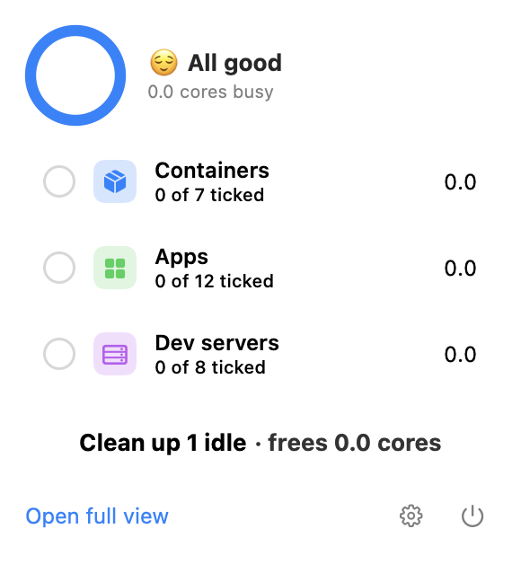
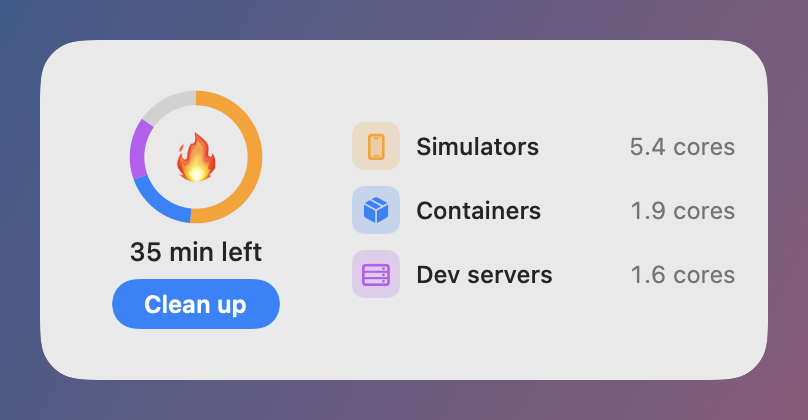

# CleanUp

**See what is draining your Mac's battery, and stop the idle culprits in one tap.**
A menu bar app, a window and a widget for macOS. It never touches anything that is in use.

<p align="center">
  
</p>

<p align="center">
  
  &nbsp;&nbsp;
  
</p>

## Why

One day a MacBook Pro lasted 30–40 minutes on a full charge. The battery was fine. Forgotten iOS Simulators, Docker containers and dev servers were burning the CPU in the background. CleanUp does that investigation for you.

## Features

- **A ring first, text second.** Each colour is one cause; the centre shows time left on battery.
- **Quick select** stops everything that looks idle. **Choose myself** lets you tick items one by one.
- **Every item is judged on its own**, and every item has a **?** that says what it is and why CleanUp thinks it is idle or in use.
- **Menu bar and widget** do the whole job without opening the window.
- **Warns on its own** when the battery drains fast and idle items are to blame. It only warns; it never stops anything by itself.

## How CleanUp decides something is idle

Every check must pass. Anything uncertain counts as **in use** and is left unticked.

| Category | Idle only when |
|---|---|
| **Simulators** | Booted for over 1 h, no app opened in the last hour, the Simulator app is not in front, and nothing (Xcode build, test runner) refers to it. |
| **Containers** | Up over 6 h, under 1% CPU for 10 quiet minutes, no connections to its ports, and under 4 kB of network traffic over that window, measured with Docker's exact byte counters. Works with Docker Desktop, OrbStack and Colima. |
| **Dev servers** | Running over 6 h, under 2% CPU, no connection in the last 30 min, and watched by CleanUp for at least 30 min. |
| **Apps** | Never pre-ticked. Shown as "not used for X h"; only you can say you are done with one. They are asked to quit normally, so they can still offer to save. |
| **Browser tabs** | Read-only. CleanUp shows a runaway tab and points you to the browser's own task manager. It never closes tabs. |
| **Restart** | Advice only, when swap is nearly full or the Mac has been up for weeks. The button opens the normal macOS Restart dialog. |

## Requirements

- macOS 26 or later
- Xcode 27 to build (there is no download yet)

## Build

```sh
brew install xcodegen
# from the repository root
cp Config/Team.xcconfig.example Config/Team.xcconfig
```

Open `Config/Team.xcconfig` and set `DEVELOPMENT_TEAM` to your Team ID. A free Apple ID works: in Xcode go to **Settings → Accounts**, sign in, and copy the ID of your "Personal Team".

```sh
xcodegen generate
open CleanUp.xcodeproj
```

Press **Run** in Xcode.

> If `DEVELOPMENT_TEAM` is empty, the App Group becomes `.io.cleanup`, the app and the widget cannot share data, and the widget will not load.

## Privacy

No network access, no analytics, no accounts. Everything is read and decided on your Mac.

## Known limitations

- The widget's **Clean up** button does nothing if CleanUp is not running. Open the app once.
- With two container engines running at once (say Docker Desktop and Colima), neither can be quit.
- Warnings need notifications to be allowed in **System Settings → Notifications → CleanUp**.
- The plain-language "What is this?" text uses Apple Intelligence. On a Mac without it, CleanUp falls back to built-in descriptions.

## Contributing

To add a category, implement `CategoryModule` and a pure judge function with tests. `Packages/CleanUpCore/Sources/CleanUpCore/Categories/Simulators.swift` is the reference: facts in, `Judgement` out, no side effects in the judge.

```sh
swift test --package-path Packages/CleanUpCore
```

## Support

CleanUp is free. If it saved your battery, you can [sponsor the project](https://github.com/sponsors).

## License

[MIT](LICENSE)
